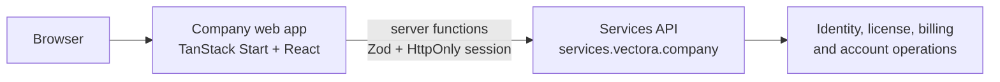

# Vectora Company

Aplicação web institucional e de conta da Vectora, publicada em `vectora.company`. O repositório contém a experiência pública do produto e as telas autenticadas de conta, assinatura e billing. A API de identidade, licença e billing é consumida remotamente pelo serviço `services.vectora.company`; este app não acessa os bancos de dados desse serviço diretamente.

Este é um repositório independente do aplicativo desktop Vectora. O código e os serviços comerciais permanecem proprietários.

## O que existe

- Páginas públicas de apresentação, recursos, downloads, FAQ, suporte, roadmap e informações legais.
- Fluxos de login, cadastro e autorização de dispositivo.
- Dashboard de conta, licença, billing e chaves de API.
- Formulários de suporte e issues enviados à API de serviços.
- Renderização web com TanStack Start, React e Vite; funções de servidor validam entradas com Zod e encaminham chamadas autenticadas à API.

As páginas e integrações podem mudar conforme a versão publicada. O código desta branch é a fonte para o comportamento implementado.

## Arquitetura



O cookie de sessão é HttpOnly e o cliente de serviços fica centralizado em `src/lib/services/client.ts`. Chamadas a APIs privadas devem permanecer em funções de servidor; segredos não podem ser expostos em variáveis `VITE_*`.

## Desenvolvimento local

Requisitos: Node.js 24, pnpm 11 e `uv` para utilitários e testes Python auxiliares.

```bash
pnpm install --frozen-lockfile
cp .env.example .env.local
pnpm dev
```

Configure em `.env.local` apenas os valores necessários para o ambiente local. Nunca versione esse arquivo. Para desenvolvimento autenticado, configure `SERVICES_URL` para uma instância disponível da API.

## Verificações

```bash
pnpm run check
pnpm run lint
pnpm run typecheck
pnpm run test
pnpm run build
pre-commit run --all-files
```

O workflow `Company` valida cada PR e, após merge em `master` ou `main`, publica na Vercel pelo alvo de produção SCons. O deploy exige `VERCEL_TOKEN` no Environment `Production`.

## Deploy e versões

Não há milestones ou automação Release Please. Cada PR passa pelas validações;
merges nas branches `master` ou `main` publicam automaticamente a versão
validada na Vercel. Consulte [CONTRIBUTING.md](CONTRIBUTING.md) e
[`.github/DEPLOYMENT.md`](.github/DEPLOYMENT.md).

## Segurança e licença

Reporte vulnerabilidades em privado seguindo [SECURITY.md](SECURITY.md). Este código é proprietário e não concede licença de uso, cópia, modificação ou redistribuição; consulte [LICENSE](LICENSE).
